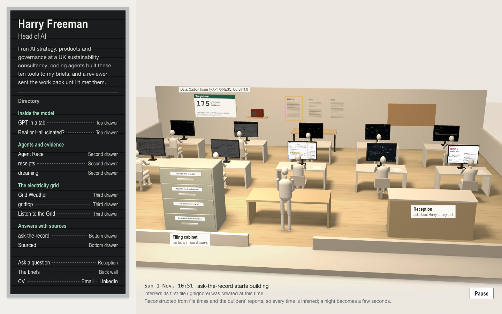

# Harry Freeman: one building

Harry Freeman's personal site, built as one building. You arrive at the door of the studio where his
ten tools were built, drawn as an architect's study model on a sheet of paper: card walls, a balsa
floor, stone-white scale figures, the directory board beside it, Reception on one side and, nearest
the door under its own soft light, the steel filing cabinet. Click the cabinet and the camera walks over; pull
a drawer and it slides out; pull a folder and the camera turns to the desk where that tool was built,
its screen playing the tool, with the folder's contents beside it: what it is, the brief it worked to,
its checks, who built and reviewed it, and **Open**, which launches it live. Esc steps back one place
at a time, and a visible button says where back is.

A builder sits at each desk and the reviewer stands at the review table. Nobody walks: in the replay
of the build, the work moves. A sheet goes from a desk to the review table, then back to the desk
tinted red when it was sent back, or on to the accepted board tinted green. At rest only the cabinet and
Reception are labelled; a desk's name appears when you point at it or reach it by keyboard.

Four things in the room are live. The lamp follows Great Britain's grid, and the current half-hour's
carbon intensity is printed on a sign on the wall, with its credit beside it. A radio on the shelf beside it plays Listen to
the Grid, silent until pressed. The sign's and the radio's cards open on hover, focus or click. Reception answers questions with quotations from Harry's CV and the tools'
READMEs; when an answer comes from a README, the camera turns to that desk and the quoted line is
marked in its folder. Every folder carries the tool's receipt stamp: its latest signed check results,
which you can check in the browser.

On a phone, with reduced motion, without WebGL or without script, the same building is the flat
office: the same directory, cabinet, folders, Reception, sign and radio as HTML. Both come from one
content source, and the directory board is the plain, accessible list in both.



The same moment of the replay before and after this redesign: [before](shots/office-4/chromium-moment-before.png), [after](shots/office-4/chromium-moment-after.png).

## On this branch: the desk

On `design/desk-miniature` the page opens on Harry's desk at real scale, filling the window, with the
studio as a living miniature on it, drawn as a management sim: zoned floors with their names painted
where nothing stands in front of them, a status gem and a name tag per builder, and the work travelling
on paths to review. The things on the desk are the site's parts (`src/desk/`):

- **The door.** Every fresh visit and every reload starts outside Harry's office door: a corridor, the
  door with its frosted pane lit warm from inside, a brass plate reading "Harry Freeman, Head of AI"
  (real text laid onto the plate), a handle and a doormat. The way in is a **knock** (the door, the button
  or Enter): two knocks, synthesised in WebAudio (a filtered-noise rap over a resonant woody body, 180
  ms apart), the door jolting and "knock" popping beside it on each; then a voice from inside, "Hello,
  welcome! ... Come and explore." (Kokoro, generated offline; `public/NOTICES.txt`), its words in a
  speech bubble from behind the door on the same beat; and as the second sentence ends the door swings
  open. Nothing touches audio before the knock's click; a speaker on the door view turns the sound off
  (remembered), and the words show either way. The door and the room behind it are the desk's
  own scene (`src/desk/room.ts`, 125 units to the metre, so the desk view's camera is a seated person's
  eyes): **Come in** (the door, the button or Enter) swings it open and walks through the room to the
  long desk under the window, lowering into the seat and ending exactly on the desk's own camera (its
  position, target, field of view and focus), so there is nothing to swap at the end. The door's poster
  paints first; the real door replaces it only once the whole desk has loaded, and Come in pressed
  before then says "Opening…" and waits. **Skip to the desk** and Esc go straight in; reduced motion
  cuts. Back and Forward (and the back-forward cache) return to the desk, and a deep link
  (`#folder-<tool>`, `#ask`), `?in`, a style or a still never show the door; `?door` always does. On
  phones (until the phone diorama) and without WebGL or script, the door is a hero above the page: a
  light door (`src/entrance/door.ts`) that opens onto warm light, or its poster, with the plate's words
  as real text and Come in a link to the content.
- **The Speak to me mic.** A podcast mic by the nameplate, with a printed tag. It never listens: no
  microphone is asked for, no permission, no audio. Clicking it (or Enter) lights its ON AIR lamp and
  opens a contact card: Harry's email with a Copy button (which says Copied only once the clipboard has
  it), LinkedIn and the CV. Esc or a click away closes it. The flat page has a plain Speak to me link in
  its header.
- **The nameplate and the card.** Harry's name and role are on a nameplate, his one-line intro and his
  CV, Email and LinkedIn links on a card beside it. Both are the page's real header text
  (`.masthead`), mapped in perspective onto the 3D faces (`room/quad.ts`), so it reads, selects, focuses
  and is in the HTML before any script. A quiet index along the foot lists the ten tools, Ask, the
  briefs and the CV, the directory for keyboards, screen readers and phones. Without WebGL the same
  header and index are a plain editorial header.

- **The model.** Click it (or scroll down) and the camera swoops in: high over the desk at first, then
  levelling out late into a low three-quarter view across the office, at the monitors, each playing its
  tool's recorded loop. The tilt-shift that makes the desk read as a miniature pulls to sharp on the way
  down. Esc, scrolling up or the visible button rises back out.
- **The index-card box** is the directory and the archive. Pull a card and its builder gets up from their screen while the
  camera leans in square to it, as if looking over their shoulder: the tool's recorded loop plays on that
  screen (a crisp video laid exactly over it once the camera has squared up; the screen's texture during
  the move), with **Open** under the bezel. The card beside it keeps the details, the stamp and the
  README lines. Whatever stands in front of the screen is cut away.
- **The notebook** is the briefs: a page a round (BRIEF, V2, V3), each line one of the tools' curated
  asks from `src/content/pieces.ts`, never the raw brief files. Turning to a round replays it.
- **The stamp and ink pad** are the receipt stamps. The card's stamp runs the real `verifyStamp`; the
  ink, PASSED, FAILED or NOT VALID, lands on the card only once the check has resolved, and a valid
  signature over failed checks (dreaming) inks FAILED beside "Signature valid".
- **The keyboard** is Reception. What you type goes into the real question box and presses the 3D keys;
  the answer prints out of a tiny printer on the model's counter as a slip with its first two
  quotations, the builder whose README answered stands, and the camera goes to their desk with the line
  marked. A refusal prints a refusal and moves nothing.
- **The sticky note** carries the grid's current half-hour in the same Caveat hand (OFL, self-hosted in
  `public/fonts/caveat`), with the NESO credit as a slip stuck under it.

`?style=classic` shows the study-model room above; the flat office is unchanged. Assets are the CC0
packs recorded in `public/assets/3d/SOURCES.json`.

## See it

Node 22.12 or later. From this folder:

```sh
npm ci --ignore-scripts
npm run build
npm run preview
```

Open **http://127.0.0.1:4400**. `?flat` shows the flat office on a large screen and `?room` the 3D room
anywhere WebGL works; `/#folder-<tool>` opens at that tool's desk. `npm run dev` serves the same with
live reload. The server binds to loopback only.

- **Open** goes to the tool on its own local port (`site.config.json`), so start that tool from its
  folder first. The two terminal tools, gridtop and dreaming, open their recorded sessions.
- **Reception** loads ask-the-record from its own folder, `~/Personal/oss/ask-the-record`: its built
  element, its transformers.js runtime, ONNX Runtime's WebAssembly and the all-MiniLM-L6-v2 model in
  its cache. The public site carries its own copies instead (`npm run build:hosted`; Hosting).
- **The radio** is Listen to the Grid's own embeddable build, vendored as built into
  `public/vendor/radio/` by `npm run vendor radio`, which copies it from
  `~/Personal/lab/listen-to-the-grid/dist-radio` only from a clean commit and writes `SOURCE.json`
  (commit `cd66469`, file hashes). It was rebuilt at that commit and matched byte for byte.

## How it is made

**One page, two renderings.** `index.html` is rendered at build time from `src/content/` (the tools,
their drawers, the CV, the briefs) into the directory, the room's labels, the flat cabinet, the floor
plan and every folder in full. A line of script in the head picks the rendering before first paint:
the room on screens at least 1000 × 620 that welcome motion and have WebGL, the office otherwise.

**The room** (`src/scene/`, `src/room/`). A 1:50 study model in Three.js on a sheet of paper, under a
work lamp, with a soft key light on the cabinet. Both lamps' light and shadows on the floor and the paper
are baked ahead of time by ray tracing the plan (`npm run bake`); figures, sheets, screens, the
cabinet's drawers and box faces are lit live, with soft contact shadows under the figures. The figures
(`people.ts`) are slim, faceless scale figures built from capsules between joints: one seated at each
desk, the reviewer standing; the builder at work only turns a little. The replay moves the work
(`work.ts`): each tool's sheet has its own place on the review table, so sheets never pile up. With
reduced motion nothing travels and the room shows the end of the build. Every screen plays its tool
from one video atlas.

The view from the door is low and a little right of the doorway, so the cabinet sits near and large in
the left third. Every object is a real button or link placed over the model, so Tab reaches each one and
Enter opens it: the cabinet, Reception, the sign, the radio and each desk from the door; each drawer (a
button lying over its front) and the folders in an open drawer at the cabinet. Tags are small printed
labels in Plex Sans Condensed set on the floor, a counter's front or a desk's front corner; for each
desk the engine picks the first spot that covers no monitor at the current size. At a desk, the
camera takes the builder's place (that figure steps out of the picture), and the tool's own loop is
mapped onto the monitor's four corners as the camera sees them (`quad.ts`), with the folder beside it.
Before the scene is ready the room shows a still of itself from the door (`npm run stills`).

**The grid.** One request, when the page opens and after each half-hour, to the NESO Carbon Intensity
API (`/intensity`, no key, CC BY 4.0) for the current national half-hour. The reading is validated
(`src/room/grid.ts`), banded as Grid Weather bands it, and shown on the sign with its half-hour and
source, printed on the sign in the scene (set in Plex on a canvas texture) and in its card; the lamps
warm and dim as carbon rises. A failed call, a malformed response or a half-hour
that is not current shows "Grid data unavailable" and leaves the light neutral; a reading is never shown
past its half-hour, and nothing is invented or cached as current.

**Reception.** ask-the-record's `highlight` attribute names the folder's README box, which shows the
tool's README as numbered source lines (ask-the-record's own `renderSourceView`, written to
`public/record/lines.json` by `npm run record:ask`, each line with `data-record-line`). When an answer
quotes a README, that README goes into the folder before the element marks the line, then the camera
turns to the desk and the folder opens scrolled to it. A refusal says so and moves nothing.

**Receipt stamps** (`src/room/stamp.ts`). Each folder, in both renderings, shows the tool's latest
stamp from the receipts project: the tool, the short commit, PASSED or FAILED and the result line,
labelled as what the stamp claims. Pressing it fetches the signed envelope and runs the receipts
project's own `verifyStamp` (WebCrypto Ed25519, the key pinned to `e201c249…`) in the browser. While it
runs the stamp says so; only when it resolves does it show the outcome, as two separate facts: whether
the signature is valid, and whether the checks passed. Then come the signed statement's commands, exit
codes, times and how they were captured, and the exact signed text. dreaming's stamp is validly signed
and records a failed unit-test run, with the reason and its separately signed supplement (run outside
the sandbox, not network-isolated). Earlier captures are listed and check too. gpt-in-a-tab's folder
can change one byte (the shipped tampered copy) to show the signature failing. A browser without
Ed25519 is told it cannot verify. What a stamp proves, and what it does not, is at `/stamps.html`, from
the receipts project's own `docs/site-stamps.md`. The packet is vendored unmodified by
`npm run vendor stamps` from receipts commit `0f84c7e`, recorded with file hashes in
`public/vendor/stamps/SOURCE.json`.

**Identity.** [IDENTITY.md](IDENTITY.md): one office building; IBM Plex throughout; putty steel, manila,
black felt and green wayfinding signs in the office; the studio is an architect's study model, in
stone, balsa and card on pale paper.

## The build timeline

`~/Personal/site-data/timeline.json`, approved by Harry, was assembled by `scripts/assemble-timeline.ts`
from evidence only: file times in each repository and the DONE lines visible in the builders' herdr
panes. No transcripts were read. Every time is inferred, and each event's note names its evidence.
Schema and rules: [docs/TIMELINE.md](docs/TIMELINE.md).

## Content

- Tool lines, techniques and checks are summarised from each README and IDENTITY.md. Checks are labelled
  _as its README reports them_: this site did not re-run them.
- The loops were recorded on 4 November 2026 from each tool's own server in a silent headless Chromium
  (`npm run record:loops`); the folders say so.
- **The CV** (`src/content/cv.md`, at `/cv.html`) includes the items once marked _to confirm_, made
  generic on Harry's decision of 3 November; nothing names a client, the employer or its product.

## Checks

```sh
npm run gate        # typecheck, lint, unit tests, build, licences (and the vendored radio's)
npm run test:e2e    # both renderings in Chromium, WebKit and Firefox, one at a time (preview on 4400)
npm run perf        # paint, scene ready, bytes, layout shift, frame times (shots/office-4/performance.json)
node scripts/moment-shots.mjs   # the busiest replay moment, before (office-3 build on :4401) and after
```

Automation is silent and offline from the world: every browser gets a device-free `AudioContext`
(`scripts/silent.mjs`), the Carbon Intensity API is always mocked, and any request off the machine fails
the check.

- **Unit tests (Vitest, 61):**
  - Reception's printout: an answer's first two quotations with their sections, a long one shortened
    with the cut marked, a refusal with its reason, and nothing printed for a result it cannot read;
  - the scale figures: about 1.75 m standing and 1.4 m seated, and at every 0.1 s step of both the
    real and the placeholder replay, no two figures' bounding boxes intersect and no part of any figure
    intersects any piece of furniture (contact within 2 mm counts as sitting or resting, not
    overlapping), with a control proving the check catches a figure pushed into its desk;
  - the receipt stamps, with their own verifier: the pinned key matches the reported fingerprint;
    every tool's latest stamp and every earlier capture verifies and names its tool and commit;
    dreaming is validly signed with failed checks, and its supplement is validly signed and marked not
    network-isolated; the tampered copy and a stamp under another key are rejected;
  - the screen overlay's transform landing exactly on a keystoned monitor's corners;
  - the grid: bands, measured value over forecast, refusing old, future, malformed and empty
    half-hours, HTTP errors, expiry, a sign that never shows a number when data is unavailable, and
    the light;
  - the room's tags: only the cabinet, Reception and the credit at rest, every object a tabbable link
    or button, and each drawer followed by its folders;
  - the earlier suites: the timeline, replay, rendering, config, CV, filing, cabinet and floor plan.
- **Browser checks (52 per browser, all passing in Chromium, WebKit and Firefox on 5 November):**
  - the desk (`scripts/desk-checks.mjs`): it opens at real scale in tilt-shift with the credit on the
    note and zero layout shift; the swoop starts high and lands low (under 30°), still high part-way;
    Esc, the button and the wheel rise out; a card pull by keyboard reaches its desk square-on (within 3°),
    the loop playing exactly over the screen at a readable size, Open under the bezel and reachable by
    Shift+Tab, and no second copy of the loop in the card; no name tag covers a screen, another tag or a
    painted zone name, and every screen is in view; the notebook's V3 page replays V3; typing at
    Reception presses one key per character and an answer prints its quotes before the desk opens with
    the line marked; a refusal prints a refusal; reduced motion cuts and nobody waves;
  - the door (`scripts/door-checks.mjs`): a fresh visit lands outside it with the plate's text, title
    unchanged, and Come in swings it open (mid-walk the door is open and the camera walking) and sits at
    the desk in 2.5 to 7 s with focus on the name, no layout shift and no audio device; the seated frame
    after the walk matches the desk loaded directly (mean difference under 2%), and at every sample of
    the walk the scene holds the real desk and no stand-ins; Come in before the desk has loaded says
    Opening… and waits; Skip and Esc go
    straight in; a reload starts at the door again and Back from the CV restores the desk; deep links
    skip it and the CV has none; reduced motion cuts; without WebGL it is the poster with the plate as
    text and Come in a link to the content; on a phone it is a hero above the page, no sideways scroll;
  - the knock: two hits 180 ms apart and the voice scheduled after them, nothing touching audio before
    the click (no AudioContext made); muted (and still muted after a reload) the words show on the same
    beat with no audio at all; Skip works mid-knock; with reduced motion the knock and the words stay,
    the door neither jolts nor swings, and it cuts in;
  - the mic: click or Enter opens the card and lights the lamp; its three links are the configured email,
    LinkedIn and CV, each focusable; Copy puts exactly the email on a (mocked) clipboard; Esc and a click
    away close it and the lamp goes off; `getUserMedia` is never called;
  - the stamps' ink: none while the check is held, then PASSED, NOT VALID for the one-byte change, and
    FAILED for dreaming beside its valid signature;
  - the HTML before scripts;
  - the first screen (directory and poster), a clean console and zero layout shift;
  - by keyboard, cabinet → drawer → folder → the desk turn → Esc back, step by step, with focus
    following;
  - Tab reaching every object at the door;
  - the pointer picking the cabinet, a drawer and a folder, and a desk (its tag showing on hover);
  - Reception's answer turning to gridtop's desk with the quoted line (790) marked and on screen, and
    Esc returning to Reception;
  - a refusal moving nothing;
  - **new:** at rest no label covers a monitor, only the cabinet, Reception and the credit are
    labelled, and every desk's tag, when shown by focus, covers no monitor either;
  - **new:** the grid credit visible at rest;
  - **new:** every card (the sign's, the radio's, Reception and the folder) fully inside the viewport
    at 1440 × 900 and 1280 × 720, and on the phone the sign, radio and folder fitting the screen with
    the credit shown;
  - the sign showing the mocked half-hour and source with the light following it, and the failure
    state with a neutral light;
  - the radio making no audio context until pressed, only device-free ones after, a visible on state,
    the credit beside it, and stopping on leaving;
  - deep links, the directory and the replay;
  - the fallback without WebGL;
  - **stamps:** a real stamp verifies in the browser, with the page checked while the check is held
    open to show that nothing says verified before it resolves; the one-byte change is rejected with
    nothing shown as fact; dreaming shows a valid signature, failed checks with the reason, its
    supplement and an earlier capture checking; a browser without Ed25519 is told it cannot verify;
    and the flat office's folder carries the same stamp on a phone;
  - the flat office: phone, reduced motion and `?flat` with no canvas and no poster download, the
    cabinet, folders, Reception's marked line, sign and radio, tabs, plan, and zero layout shift on the
    phone.

## Measured

Production build on loopback, 1440 × 900 at 2× and 390 × 844 at 3×, three cold runs per browser, on a
shared machine (`shots/office-4/performance.json`). Medians:

|                                  | Chromium | WebKit | Firefox |
| -------------------------------- | -------- | ------ | ------- |
| First contentful paint (desktop) | 40 ms    | 33 ms  | 36 ms   |
| Scene ready (desktop)            | 102 ms   | 136 ms | 128 ms  |
| Transferred at scene ready       | 556 KB   | 412 KB | 544 KB  |
| First contentful paint (phone)   | 52 ms    | 38 ms  | 36 ms   |
| Transferred on the phone         | 160 KB   | 159 KB | 160 KB  |
| Layout shift (desktop, phone)    | 0, 0     | n/a    | n/a     |

Frame times (median / 95th percentile): Chromium, vsync-locked, 16.7 / 16.8 ms at the door, walking
to the cabinet, opening a drawer and turning to a desk, with no frame over 20 ms in any run. Headless
WebKit and Firefox run their frames unthrottled at about 6 / 7 ms, which shows headroom, not what a
display would pace. WebKit and Firefox do not report layout shift; it is measured in Chromium.

## What is weak

- **Loopback numbers.** Paint and scene-ready times are from a local preview; over a network the
  three.js chunk (142 KB gzipped) and the baked textures add their transfer time.
- **The poster is one framing.** It is shot at the hall's shape on a laptop; on much wider screens the
  live room frames slightly differently from the still it fades in over.
- **At a desk, its builder steps out of the picture.** The camera takes the builder's place to see the
  whole screen over the desk; the other figures stay.
- **Tags choose their spot per size.** At unusual window shapes a desk's tag may land on the floor
  before its chair rather than on the desk's corner; the check covers 1440 × 900 and 1280 × 720.
- **The printed sign is small from the door.** The number reads; the detail is in its card.
- **Safari's own Tab order.** Room objects carry an explicit tabindex so Safari's default Tab reaches
  them; the directory's plain links follow Safari's setting (Option-Tab), as on any site.
- The timeline's times are inferred from file times; three hand-ins come from pane DONE lines.
- Meaning search is heavy (about 50 MB on first use, mostly ONNX Runtime's WebAssembly).
- Not deployed yet. The hosted build, its headers, the gate and the deploy script are ready (Hosting).
- **Hugging Face's weights host is pinned as measured** (`us.aws.cdn.hf.co`, where `huggingface.co`
  redirects the model). If Hugging Face moves the file to another host, the policy blocks it and
  Reception answers by keywords only until the host is added; `https://*.hf.co` would be the looser
  choice.
- **The local checks are not Cloudflare.** wrangler's Pages emulation serves the headers, the redirects
  and the 404 as Pages does, but not byte ranges; check the live site (Hosting, Attach the domain).
- Not tested with a real screen reader, or in real Safari: Harry will try it.

## Hosting

The public site is the hosted build of this folder on Cloudflare Pages, on Harry's personal Cloudflare
account, project `harryfreeman-studio`, served at **https://harryfreeman.dev**. Where it lives, and the
one indexing switch, are in [hosting.config.json](hosting.config.json). The code for it is in
`src/hosting/`; the site's own files change only at a few guarded call sites.

**What is public.** Everything in `dist/` after `npm run build:hosted`: the pages, the loops and stills,
the casts, the vendored radio and stamps, Reception's record (redacted, below) and its runtime, the
fonts, `NOTICES.txt`. Nothing else: no source, no source maps, nothing from Harry's machine.

**What hosted mode changes** (`VITE_HOSTED=1`, set by `npm run build:hosted`):

- **The tools on local ports.** Eight of the ten tools run on Harry's machine (`site.config.json`). Their
  folders say "Runs on Harry’s machine; this is a recording of the real tool." where Open was, with no
  link, and the recorded loop keeps playing on the screen (`src/hosting/open.ts`). gridtop and dreaming
  keep Open: their recorded sessions are on this site. The colophon, the footer and the cabinet's line
  say the same (`src/hosting/html.ts`), and each of those changes must apply exactly or the build fails.
- **Reception.** The element is vendored in `public/vendor/ask-the-record/` with its MIT licence and
  `SOURCE.json` (commit `138597c`), by `npm run vendor:reception`: it clones that commit, installs it
  from its lockfile, builds it, and refuses unless the result is byte for byte ask-the-record's own
  `dist/`. transformers.js 4.3.2 and ONNX Runtime Web's WebAssembly are copied into the build from
  ask-the-record's install only if they match their pins (version, npm integrity, SHA-256) in
  `src/hosting/reception.json`, with their licences. The model, all-MiniLM-L6-v2, comes from Hugging
  Face, where it is published, as ask-the-record does off loopback (no `model-host`). ONNX Runtime's
  WebGPU-capable build is 25.6 MiB, over Pages' 25 MiB a file, so it is served in two parts that
  `/vendor/transformers/runtime-hosted.js` joins and runs only if the result has the pinned length and
  SHA-256; it runs whichever build transformers.js itself picks for the browser.
- **The record.** `npm run record:hosted` rebuilds Reception's record from exactly the sources the
  committed one was built from (each found by its SHA-256 in `public/record/sources.json`: the file, or
  its version in its repository's history), with local addresses and `~/Personal` paths replaced by
  "(local setup)" (`src/hosting/redact.ts`). Only those spans change, so every fact keeps its line and
  every citation still lands on it; the build compares the two records (same sources, sections, lines
  and fact positions; a changed fact must carry the marker) before it uses the hosted one. Today: 17
  spans.
- **`loops/report.json`** keeps when each loop was recorded, not the local address it was recorded
  from. Pages, canonical links, `og:url` and the social card use `https://harryfreeman.dev`. A missing
  path gets a 404 page (Pages would otherwise answer with the studio).

**Headers** ([public/_headers](public/_headers), filled by the build). A Content-Security-Policy that
allows exactly what was measured on every station (below):

- `default-src 'none'`: everything not listed is refused.
- `script-src 'self'`, the head script's hash and `'wasm-unsafe-eval'` (ONNX Runtime compiles WebAssembly).
- `style-src-elem 'self'`; `style-src-attr 'unsafe-hashes'` with the hash of each style attribute in the
  pages: the flat cabinet's eight custom properties (`style="--i:0"` and so on), one by one, never
  `'unsafe-inline'`.
- `img-src`, `font-src` and `media-src 'self'`: stills and textures, Plex and Caveat, the loops.
- `connect-src 'self' https://api.carbonintensity.org.uk https://huggingface.co https://us.aws.cdn.hf.co`:
  the record, stamps, casts and voice; the grid; the model, and the host Hugging Face redirects its
  weights to.
- `worker-src 'self' blob:`: ask-the-record's model worker is a `blob:`, and it imports the runtime from
  this site, which Firefox checks against `worker-src`.
- `base-uri`, `form-action`, `frame-ancestors` and `object-src 'none'`.

The terminal page (`/terminal`) gets the same policy with only `style-src-elem` widened to
`'unsafe-inline'`: xterm.js writes its theme and its measured cell sizes into `<style>` elements, which
cannot be hashed ahead. The build derives it from the main policy and the gate refuses any other
difference. Also on every response: `Referrer-Policy: strict-origin-when-cross-origin`;
`X-Content-Type-Options: nosniff`; a `Permissions-Policy` denying camera, microphone and geolocation and
allowing the accelerometer and gyroscope for this site only; HSTS (the `.dev` domain is preloaded
anyway); no `Access-Control-Allow-Origin` (Pages adds `*` by default); and immutable caching for Vite's
hashed `/assets/`.

**Indexing.** `SITE_INDEXABLE` in `hosting.config.json` is the one switch. While it is `false`, every
response carries `X-Robots-Tag: noindex, nofollow` and `robots.txt` disallows everything; set it to
`true` at launch, commit and redeploy, and both go. (A crawler that obeys `robots.txt` never fetches a
page to see its noindex, so after launch the two must change together, which the switch ensures.)

**The gate** (`npm run check:predeploy`, `scripts/predeploy-check.mjs`, rules in `src/hosting/gate.ts`,
unit-tested) reads every file in `dist/` and fails closed on: a name from the denylist, which lives
outside every repository (`~/Personal/.site-gate/denylist.txt`, or `SITE_GATE_DENYLIST`; one name per
line, `#` comments, case-insensitive whole words; the gate stops if it is missing, empty or inside a
repository, and reports only how many names it checked and which files hit); home paths, localhost and
127.0.0.1, plain `http://` URLs, source maps, `.env` files and key-shaped strings; any email but the
personal one in `site.config.json`; a file over 25 MiB or more than 20,000 files; `_headers` missing,
unfilled, out of step with `SITE_INDEXABLE` or not allowing every inline script, and `robots.txt` out of
step; and a build that is not the hosted one. Binary files are read as their printable text (runs of six
or more characters, as `strings` reads metadata). Each reviewed exception is an exact string in an
exact file (`EXCEPTIONS` in `gate.ts`): JSON Schema ids and an IPv6 template literal in the radio's
bundle; the capture path inside dreaming's signed stamps (redacting it would break the signatures);
Emscripten's virtual `/home/web_user` in ONNX Runtime; dreaming's synthetic `/home/sam` in its cast;
licence texts' own `http://` addresses. Then it runs the typecheck, the lint and the unit tests.

**Checked in a browser** (`npm run check:hosted`, `scripts/hosted-checks.mjs`). The hosted build is served
by wrangler's own Pages emulation with its `_headers`, behind a TLS front with a throwaway certificate
for harryfreeman.dev, and each browser reaches it through a local proxy: the page runs at
`https://harryfreeman.dev`, in a secure context, off loopback. The proxy lets only Hugging Face out to
the network; the Carbon Intensity API is mocked; anything else is refused. Every station is driven: the
door and its knock (audio device-free, as in every check), the desk, the dive, the notebook, the grid
note, the mic, a card with its loop and its recording line, its stamp checked, Reception answering a
question of its own by meaning search, the radio playing, the flat office on a phone, the CV, the stamps
page, both terminal sessions and a missing page. `measure` runs the policy report-only and records every
origin and kind of request; the default runs it enforced and fails on any violation. Measured on 5
November 2026 and then enforced: all seven stations pass in Chromium, Firefox and WebKit with no
violation and nothing the site asked for refused; meaning search ran from Hugging Face's model on WebGPU
(Chromium, WebKit) and WebAssembly (Firefox), its vectors checked against the record's. The reports are
in `shots/hosted/`. The browsers' own background traffic (update and autofill services) is refused by
the proxy and listed apart; the page never asked for it.

**Deploy** (`npm run deploy`, `scripts/deploy.mjs`): refuses uncommitted changes; builds the hosted site
and runs the gate; asks wrangler who it is logged in as and refuses unless the email is exactly the
personal one in `site.config.json` with one account (it prints the account); creates the Pages project,
production branch `main`, if it is missing; deploys `dist/` to production; prints the URLs. wrangler
4.158.0 is pinned exactly in `tools/deploy/` with its own lockfile, apart from the site's dependencies,
because it brings LGPL-3.0 and CC0 packages that `npm run licences` does not allow; none of it reaches
`dist/`. Its telemetry is off. `npm run deploy -- --check` does everything but create and deploy.

**Attach the domain** (once): Cloudflare dashboard → Workers & Pages → `harryfreeman-studio` → Custom
domains → Set up a custom domain → `harryfreeman.dev`. The domain is in the same account, so Pages adds
the DNS record itself. Then check it: `curl -sI https://harryfreeman.dev/` shows the headers above, and
`curl -sI https://harryfreeman.dev/terminal` carries only the terminal page's policy, and
`curl -sI -H 'Range: bytes=0-99' https://harryfreeman.dev/loops/gridtop.webm` answers 206 (Safari needs
ranges for video; wrangler's local emulation does not do them, so only the real site can show this).

**Take it down**: remove the custom domain (same page → Custom domains → Remove), then delete the
project (Settings → Delete project), or `npx --prefix tools/deploy wrangler pages project delete
harryfreeman-studio`. A single bad deployment can be rolled back instead: Deployments → an earlier one →
Rollback.

## Credits and licences

Code: MIT, Copyright (c) 2026 Harry Freeman. Data: carbon intensity from the NESO Carbon Intensity API,
CC BY 4.0, credited at rest beside the sign and the radio, on the printed sign and in both cards. Everything else third-party (three.js, Valibot,
xterm.js, the vendored radio and the zod inside it, ask-the-record, transformers.js, ONNX Runtime Web,
all-MiniLM-L6-v2, IBM Plex) is listed with its licence in [public/NOTICES.txt](public/NOTICES.txt),
served at `/NOTICES.txt`. `npm run licences` checks every installed package is MIT, Apache-2.0, BSD or
ISC (the fonts aside) and that the vendored radio carries its MIT licence and source record. Vite is
pinned to 7.3.7 because Vite 8 brings in lightningcss, which is MPL-2.0. Nothing here is hosted or
published.
